<div align="center">


<br>

# Prism India

### *Same search, different India.*

**Run one Google search from six Indian cities, in two languages, and see exactly what changes.**
Measure information inequality, then use seven free public-interest tools built on the same idea.

<br>


<br>

[✨ Features](#-features) &nbsp;·&nbsp; [📸 Screenshots](#-screenshots) &nbsp;·&nbsp; [🌐 Language Gap Lab](#-language-gap-lab) &nbsp;·&nbsp; [🧰 Public tools](#-public-tools) &nbsp;·&nbsp; [🔌 SerpApi](#-how-it-uses-serpapi) &nbsp;·&nbsp; [🚀 Quick start](#-quick-start) &nbsp;·&nbsp; [🏆 Submission](#-hackathon-submission)

<br>

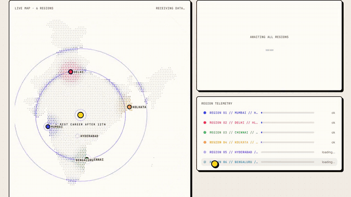

<sub>One search → six cities → one Divergence Score. Beacons light up the moment each city's real data arrives.</sub>

</div>

<br>

## 🧭 Why this exists

<table>
<tr>
<td width="33%" valign="top">

### 🌍 Information inequality
The web a person sees depends on **where they stand** and **which language they search in**. Nobody measures that gap.

</td>
<td width="33%" valign="top">

### 🏙️ Local bias
A city's top 10 can be filled with sources that **never appear anywhere else**, and miss the official ones.

</td>
<td width="33%" valign="top">

### 🚨 Misinformation exposure
When featured answers and sources differ by region, so does the answer people **trust and act on**.

</td>
</tr>
</table>

Prism makes the gap **visible** (map, matrix, blind spots), **measurable** (a transparent 0-100 score) and **actionable** (free tools that point people to trustworthy sources).

<br>

## ✨ Features

<table>
<tr>
<td width="50%" valign="top">

#### 🗺️ Living dot-matrix map
Six beacons that pulse faster as their results diverge from consensus. Hover for a city's top 3, click to zoom in. Dashed red arcs mark cities sharing **under 20%** of results.

</td>
<td width="50%" valign="top">

#### 📊 Divergence Score, no black box
One 0-100 number with a visible formula, Jaccard overlap, Spearman rank correlation and a **Reality Tear** glitch when divergence is extreme.

</td>
</tr>
<tr>
<td valign="top">

#### 🌐 Language Gap Lab *(new)*
Same city, same question, **local language vs English**. Scores how many pages change and how **authoritative** the sources are.

</td>
<td valign="top">

#### 🛡️ Source trust profile
Every result is classified: official, academic, fact-check, reference, news, commercial or social. See which city gets the best mix.

</td>
</tr>
<tr>
<td valign="top">

#### 🕳️ Blind spots
Pages that rank high in other cities but never reach one. Shown **redacted** and decrypted with a character-scramble animation.

</td>
<td valign="top">

#### 🪞 Split reality
Pick two cities and drag the divider. Shared results are linked by lines; unique ones glow in each city's colour.

</td>
</tr>
<tr>
<td valign="top">

#### 🧰 Seven public tools
Education, research, jobs, news literacy, civic information, patents and accessibility, each mapped to a **UN SDG**.

</td>
<td valign="top">

#### 🎙️ Voice, WhatsApp and share cards
Search by voice in six Indian languages. Share on **WhatsApp** or export a 1200×630 report poster as PNG.

</td>
</tr>
<tr>
<td valign="top">

#### ♿ Accessible by design
Skip link, keyboard shortcuts, ARIA labels, read-aloud, and a site-wide **Display** panel: text size, high contrast, easy-read font, calm motion.

</td>
<td valign="top">

#### 💸 Built to use few credits
At most **one search per tool**, per-data-type caching, a credit estimate on every button, and a full **offline Demo mode** that costs nothing.

</td>
</tr>
</table>

<br>

## 📸 Screenshots

<table>
<tr>
<td width="50%">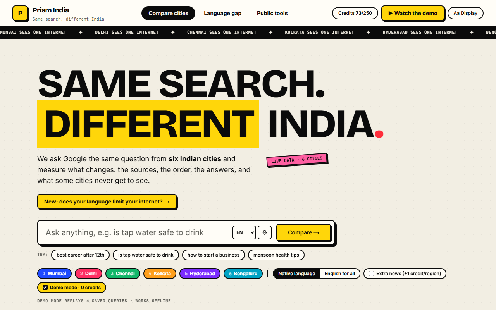<br><sub><b>Home</b>: one search box, six cities, two languages</sub></td>
<td width="50%">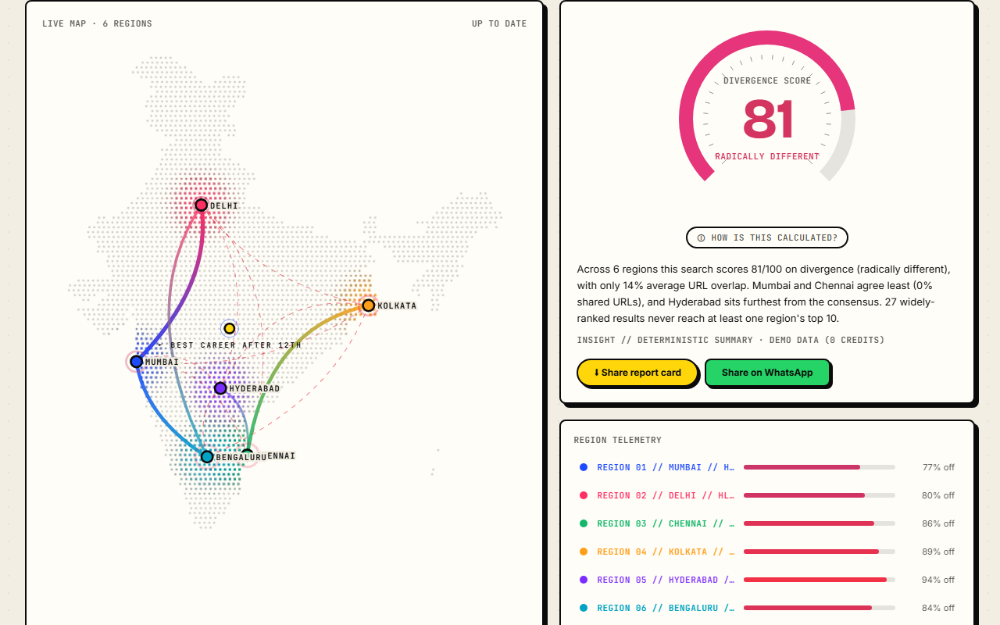<br><sub><b>Map + Divergence Score</b>: arcs thicken with overlap</sub></td>
</tr>
<tr>
<td>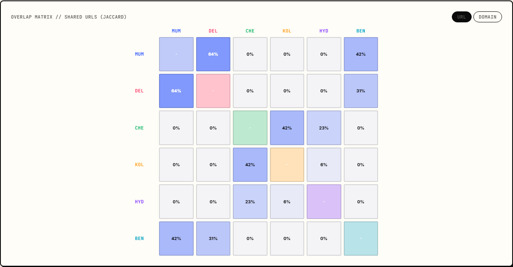<br><sub><b>Overlap matrix</b>: how much each pair of cities agrees</sub></td>
<td>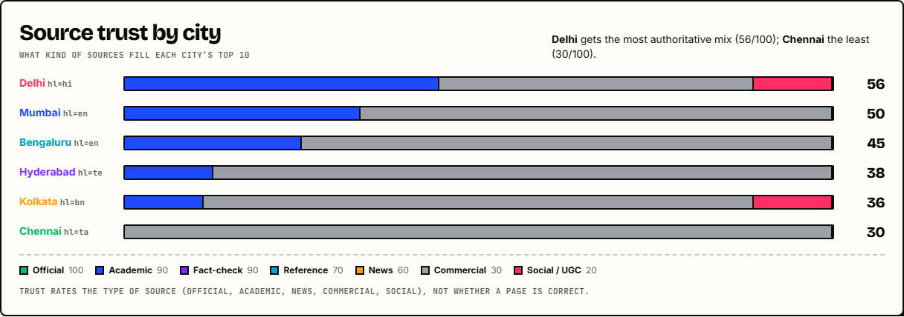<br><sub><b>Source trust</b>: official, academic, news, commercial, social</sub></td>
</tr>
<tr>
<td>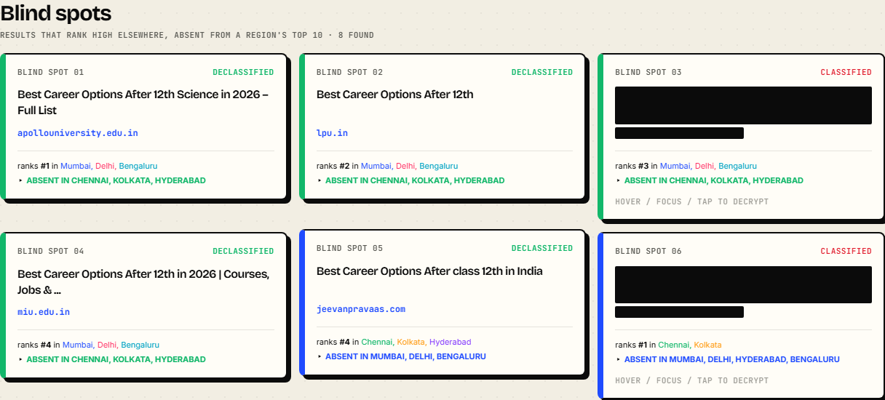<br><sub><b>Blind spots</b>: classified until you hover</sub></td>
<td>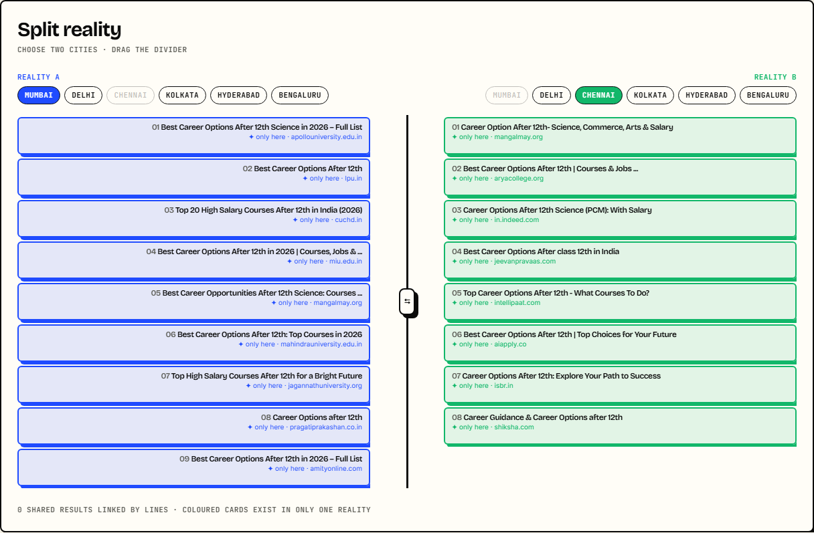<br><sub><b>Split reality</b>: two cities, one draggable divider</sub></td>
</tr>
<tr>
<td>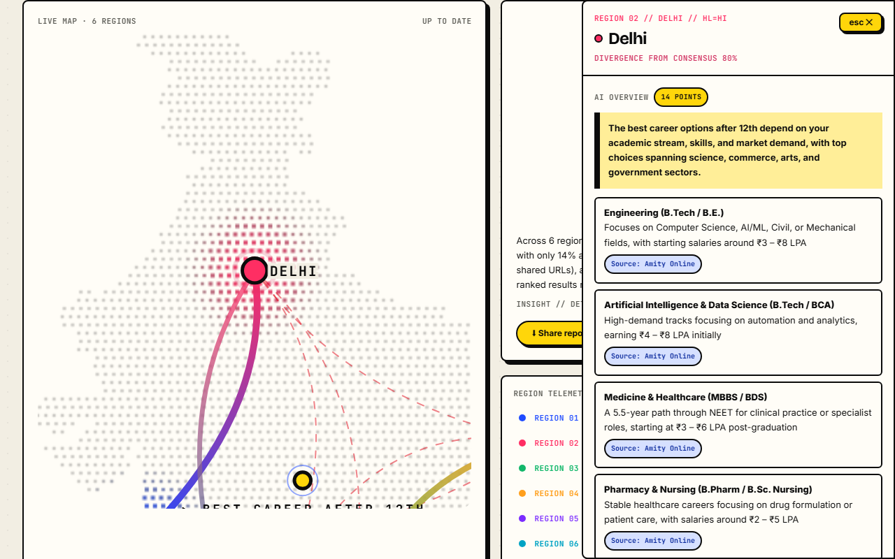<br><sub><b>City detail</b>: tidy AI Overview with sources</sub></td>
<td>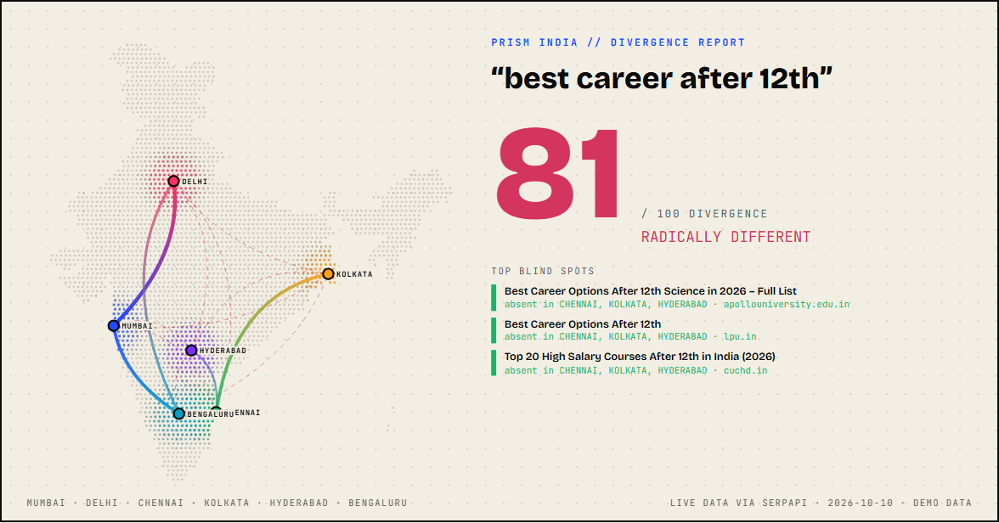<br><sub><b>Share card</b>: 1200×630 PNG poster</sub></td>
</tr>
</table>

<details>
<summary><b>More screenshots</b> (public tools and accessibility)</summary>

<br>

<table>
<tr>
<td width="50%">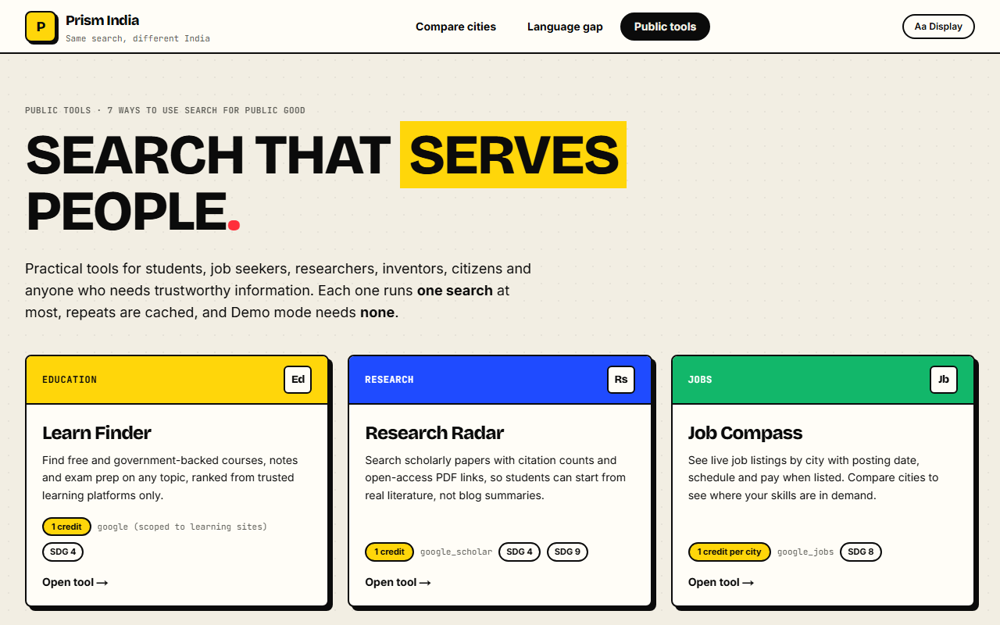<br><sub><b>Public tools hub</b></sub></td>
<td width="50%">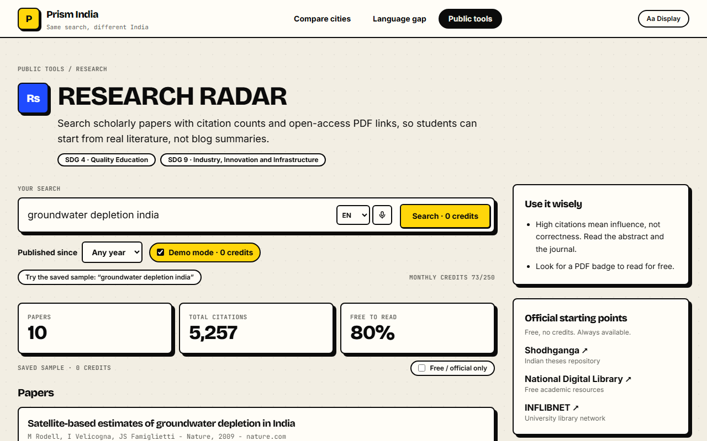<br><sub><b>Research Radar</b>: papers, citations, free PDFs</sub></td>
</tr>
<tr>
<td>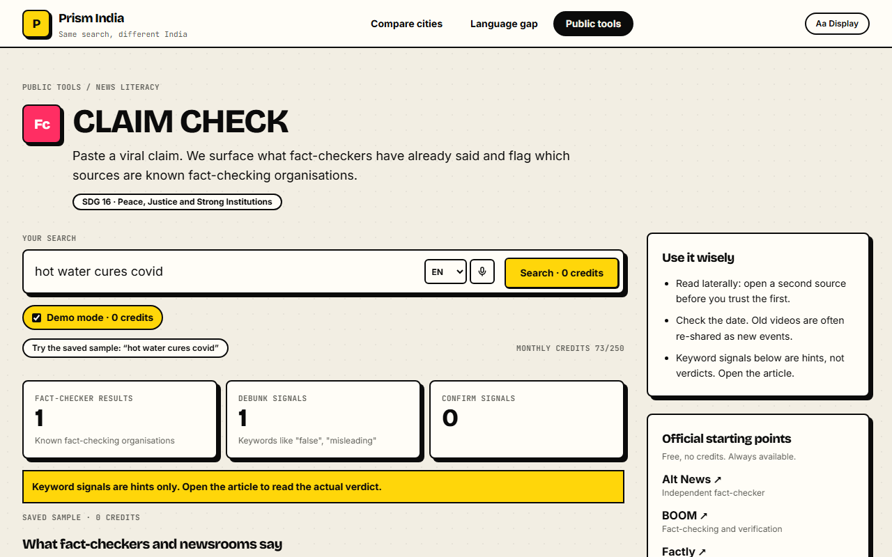<br><sub><b>Claim Check</b>: what fact-checkers already said</sub></td>
<td>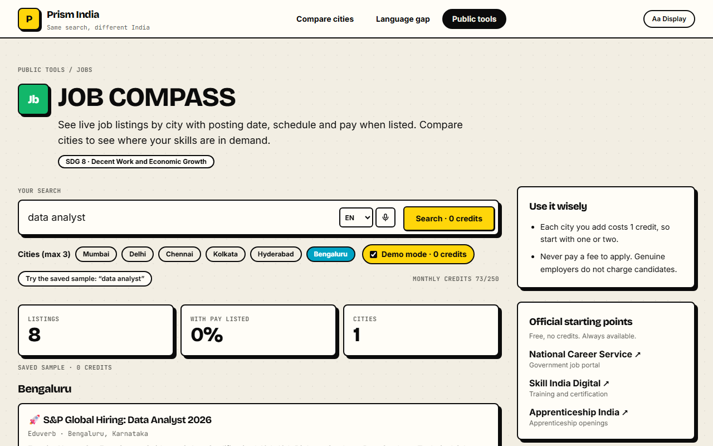<br><sub><b>Job Compass</b>: live listings by city</sub></td>
</tr>
<tr>
<td colspan="2">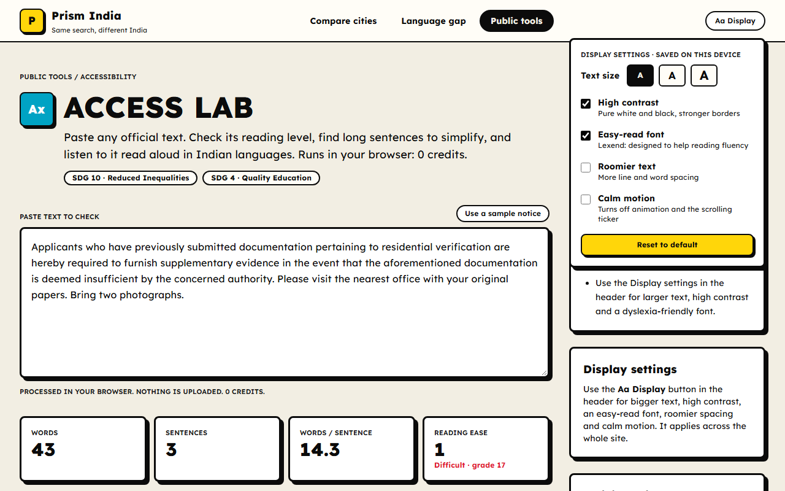<br><sub><b>Access Lab</b> with high contrast and the easy-read font switched on</sub></td>
</tr>
</table>

</details>

<br>

## 🌐 Language Gap Lab

> **Does your language limit your internet?**

For each city whose native Google language isn't English (Delhi, Chennai, Kolkata, Hyderabad), Prism runs the **same query twice from the same location**, once in the local language and once in English, then compares pages, domains and source authority.

<div align="center">
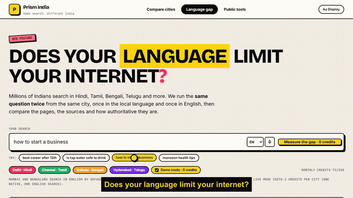
</div>

<br>

**What the saved demo data shows** (query: *"how to start a business"*):

| | Result |
|---|---|
| 🌐 Pages that change when you switch language | **77%** on average across 4 cities |
| 🇮🇳 Chennai, Tamil vs English source trust | **25 vs 70** out of 100 |
| 🏛️ What only English searchers saw in Chennai | An official `india.gov.in` portal and a World Bank page |
| ⚖️ Direction | Reported both ways: the local language is sometimes **better** (e.g. Delhi in Hindi for careers) |

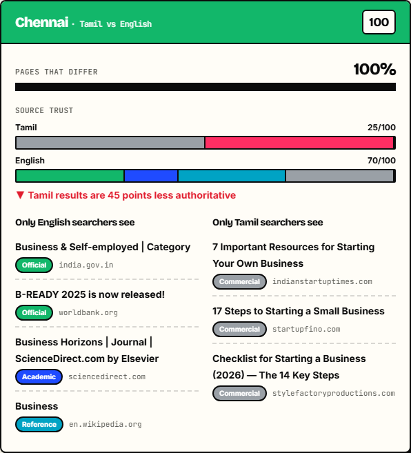

<details>
<summary><b>How the Language Gap Index is calculated</b></summary>

```
Language Gap = 100 × ( 0.50 × page difference
                     + 0.30 × domain difference
                     + 0.20 × authority shortfall )
```

- **Page / domain difference** = 1 − Jaccard overlap of native vs English results.
- **Authority shortfall** = trust points the native results lose vs English, ÷ 40, capped at 1 (0 when native is better).
- **Trust** comes from `lib/trust.ts`: an auditable domain list that classifies each result as official (100), academic (90), fact-check (90), reference (70), news (60), commercial (30) or social (20). It rates the *type* of source, not whether a page is correct.

</details>

Live mode costs **2 credits per city** (one native, one English search). Demo mode costs 0.

<br>

## 🧰 Public tools

Seven tools share one accessible workbench. Each runs **at most one SerpApi search**, results are cached, and **no AI model is called**.

| | Tool | Need | SerpApi engine | Credits | SDG |
|:-:|---|---|---|:-:|:-:|
| 🎓 | **Learn Finder** | Education | `google` scoped to `gov.in` / `nic.in` / `ac.in` | 1 | 4 |
| 🔬 | **Research Radar** | Research | `google_scholar` | 1 | 4 · 9 |
| 💼 | **Job Compass** | Jobs | `google_jobs` (up to 3 cities) | 1 / city | 8 |
| 🕵️ | **Claim Check** | News literacy | `google` + "fact check" | 1 | 16 |
| 🏛️ | **Civic Guide** | Civic information | `google` scoped to government sites, 10 languages | 1 | 16 · 10 |
| 💡 | **Patent Scout** | Patents | `google_patents` | 1 | 9 |
| ♿ | **Access Lab** | Accessibility | none, runs in your browser | **0** | 10 · 4 |

Each tool page also lists **free official starting points** (SWAYAM, Passport Seva, Alt News, IP India, …) that work without spending a credit.

<br>

## 🔌 How it uses SerpApi

All calls are **server-side**; the key never reaches the browser.

| SerpApi engine | Parameters | Used for |
|---|---|---|
| `google` | `q`, `location`, `gl=in`, `hl`, `google_domain=google.co.in`, `num=10` | Per-city organic results, featured snippets, AI Overviews, related questions, top stories; the native-vs-English comparison; Claim Check, Civic Guide, Learn Finder |
| `google_news` | `q`, `gl=in`, `hl` | Optional extra news per language edition |
| `google_scholar` | `q`, `as_ylo` | Research Radar |
| `google_jobs` | `q`, `location` | Job Compass |
| `google_patents` | `q`, `country`, `sort` | Patent Scout |

**Why it is essential:** `location` is what makes per-city results possible, `hl` is what makes native-language comparison possible, and the scholar, jobs and patents engines power the public tools. Nothing here could be built from a generic search API.

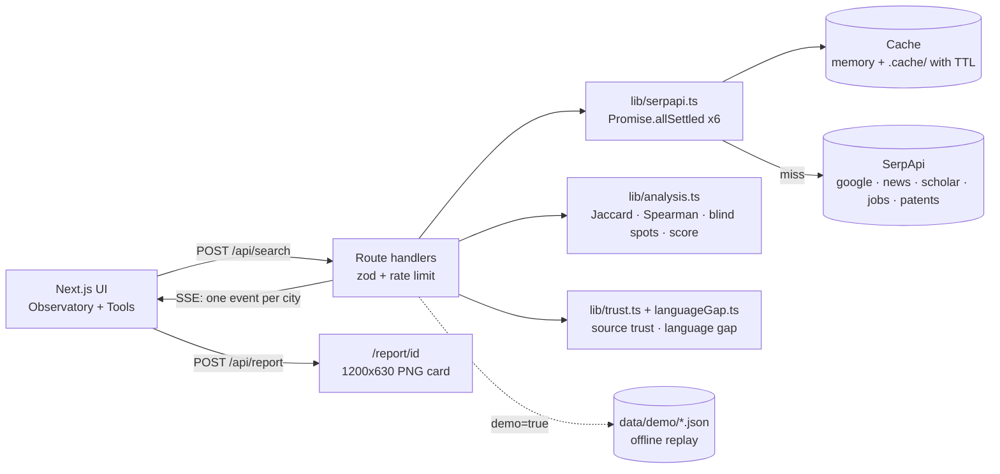

<br>

## 📐 Scoring formulas

<details>
<summary><b>Divergence Score (0-100)</b></summary>

```
Divergence = 100 × ( 0.40 · URL distance
                   + 0.20 · domain distance
                   + 0.15 · rank disagreement
                   + 0.15 · blind-spot pressure
                   + 0.10 · answer divergence )
```

- **URL / domain distance** = 1 − mean pairwise Jaccard over normalized URLs (tracking params, `www`, trailing slash stripped) and domains.
- **Rank disagreement** = mean (1 − Spearman ρ) / 2 over each pair's shared results (1 when fewer than 2 are shared).
- **Blind-spot pressure** = blind spots ÷ (3 × regions), capped at 1. A blind spot is a URL in the top 5 of at least two regions but absent from another region's top 10.
- **Answer divergence** = share of region pairs whose featured snippet / AI Overview text differs.
- **Per-city divergence** (beacon speed and colour) = 1 − mean(0.6 · URL Jaccard + 0.4 · domain Jaccard) against the other cities.

</details>

<br>

## 🚀 Quick start

```bash
git clone https://github.com/Ayushpund/prism-india.git
cd prism-india
npm install
cp .env.example .env.local      # Windows: copy .env.example .env.local
# add SERPAPI_API_KEY=...  (ANTHROPIC_API_KEY is optional)
npm run dev                      # http://localhost:3000
npm test                         # 17 unit tests
```

> 🎬 **No API key? No problem.** **Demo mode** is on by default: it replays saved searches from `data/demo/` with **zero credits** and works fully offline. Click **▶ Watch the demo** in the header for a scripted ~60 s walkthrough.

<details>
<summary><b>Useful scripts</b></summary>

| Command | What it does |
|---|---|
| `node scripts/record-demo.mjs <url>` | Re-record the 4 compare demo queries (native). Add `english` for the English set |
| `node scripts/record-tools.mjs <url>` | Re-record one sample per public tool (6 credits) |
| `node scripts/build-india.mjs <topojson>` | Rebuild the simplified India outline |
| `node scripts/make-banner.mjs` | Regenerate the animated README banner |

</details>

<details>
<summary><b>⌨️ Keyboard shortcuts</b></summary>

| Key | Action |
|:-:|---|
| `/` | Focus the search box |
| `1` – `6` | Toggle a city on or off |
| `Esc` | Close a panel, or stop the cinematic demo |

</details>

<br>

## 🗂️ Project structure

```text
.
├── app/
│   ├── page.tsx                    # Compare-cities Observatory
│   ├── language-gap/               # Language Gap Lab
│   ├── tools/ and tools/[id]/      # Public tools hub + one page per tool
│   ├── report/[id]/                # Shareable 1200x630 report card
│   └── api/  search · tool · language-gap · report
├── components/                     # IndiaMap, ScoreGauge, OverlapMatrix, BlindSpots,
│                                   # SplitReality, TrustProfile, ToolWorkbench, AccessLab, …
├── lib/
│   ├── serpapi.ts  cache.ts        # server-side client + cache with TTL
│   ├── analysis.ts trust.ts languageGap.ts
│   ├── toolsMeta.ts toolsServer.ts # tool registry + per-engine parsers
│   └── schema.ts ratelimit.ts reports.ts demo.ts insight.ts
├── data/demo/                      # saved searches for offline Demo mode
├── tests/                          # Vitest: analysis, trust, language gap
├── scripts/                        # record demos, build map, make banner
└── docs/images/                    # README banner, screenshots, GIFs
```

<br>

## ⚠️ Limitations

<details>
<summary>Please read before quoting any number</summary>

- Google results vary with **personalization, time and device**. Each run is a snapshot, not a verdict.
- SerpApi **simulates** a location; it approximates a local searcher, not an actual resident.
- **Trust scores rate the type of source**, not whether a page is true. Unknown domains default to "commercial".
- The language gap is reported in **both directions**: sometimes the local language returns better sources.
- AI Overviews often need a second paid call (`page_token`); they are only shown when returned inline.
- The map uses a simplified, district-merged outline of India; dot positions are approximate.
- Rate limiting and the file cache are per-process, so they are not meant for multi-instance deployments as-is.

</details>

<br>

## 🏆 Hackathon submission

### Project description and track

**Track:** Knowledge & Public Interest

**What it does.** Prism India shows how Google results differ across India. It runs the same search from six cities (Mumbai, Delhi, Chennai, Kolkata, Hyderabad, Bengaluru), scores the gap on a transparent 0-100 Divergence Score, and shows exactly which sources each city sees and which it never gets to see. Its **Language Gap Lab** runs the same query twice from one city, in the local language and in English, and measures how many pages change and how authoritative the sources are. Alongside this are seven free public-interest tools for education, research, jobs, news literacy, civic information, patents and accessibility.

**Who it helps.**
- 🎓 Students and job seekers who need trustworthy, free learning and career information.
- 🏛️ Citizens who need official government answers, in their own language.
- 🔬 Researchers, inventors, journalists and fact-checkers.
- 🗣️ Anyone who searches in a language other than English and may be getting weaker sources.
- ♿ People with assistive needs: voice search, read-aloud, high contrast, an easy-read font and calm motion are built in.

**How it uses SerpApi.** See [How it uses SerpApi](#-how-it-uses-serpapi) above: five engines (`google`, `google_news`, `google_scholar`, `google_jobs`, `google_patents`), all server-side, with per-engine caching and an offline Demo mode.

📄 More: [PITCH.md](PITCH.md) has the pitch, SDG mapping and a 3-minute demo script.
🎬 Demo video: _add your video link here after uploading_.

### Participant details

| | |
|---|---|
| **Lead participant** | Ayush Pund |
| **Organisation** | Welyft |
| **Email** | ayushpund12345@gmail.com |
| **Phone** | 8446204947 |
| **Occupation** | Software engineer |
| **Years of experience** | _[add before submitting]_ |
| **Teammates (name, email)** | _[add before submitting, or write "none"]_ |

### Disclosures and agreement

- **Did the project already exist?** _[confirm before submitting]_ This codebase was built from scratch for this hackathon, with no earlier version.
- **AI tools used:**
  - **Claude Code (Anthropic, Claude Sonnet 5.5):** used to design, write and test the code, the demo data pipeline, this README and the pitch.
  - **Microsoft Edge neural text-to-speech ("en-IN-PrabhatNeural"):** voiceover for the demo video only.
  - **Runtime (optional):** the Anthropic API writes a 3-sentence insight only if `ANTHROPIC_API_KEY` is set; otherwise a deterministic template is used. The public tools do not call any AI model.
- **Rules and Terms & Conditions:** [ ] I have read and accept the hackathon Rules and Terms & Conditions. _(The participant must tick this box themselves.)_

<br>

## 🙌 Acknowledgements

Search data by [SerpApi](https://serpapi.com). Built with [Next.js](https://nextjs.org), [Tailwind CSS](https://tailwindcss.com), [Framer Motion](https://www.framer.com/motion/), [d3-geo](https://github.com/d3/d3-geo) and [Vitest](https://vitest.dev). District boundaries from the open [india-maps-data](https://github.com/udit-001/india-maps-data) project.

## 📄 License

[MIT](LICENSE) © Prism India contributors

<div align="center">
<br>

**If this made you look at search differently, give it a ⭐**

<sub>Same search. Different India.</sub>

</div>
