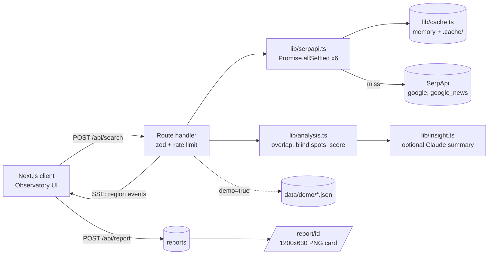

# Prism India

> *Same search, different India.*

A "Search Observatory" that runs the **same Google query from six Indian cities** (Mumbai, Delhi, Chennai, Kolkata, Hyderabad, Bengaluru) using live [SerpApi](https://serpapi.com) data, then shows how much the results differ: what each city sees, and what it never gets to see.

## Hackathon submission

### Project description and track

**Track:** Knowledge & Public Interest

**What it does.** Prism India shows how Google results differ across India. It runs the same search from six cities (Mumbai, Delhi, Chennai, Kolkata, Hyderabad, Bengaluru), scores the gap on a transparent 0-100 Divergence Score, and shows exactly which sources each city sees and which it never gets to see. Its **Language Gap Lab** runs the same query twice from one city, in the local language and in English, and measures how many pages change and how authoritative the sources are. Alongside this are seven free public-interest tools: Learn Finder (education), Research Radar (research), Job Compass (jobs), Claim Check (news literacy), Civic Guide (civic information), Patent Scout (patents) and Access Lab (accessibility).

**Who it helps.**
- Students and job seekers who need trustworthy, free learning and career information.
- Citizens who need official government answers, in their own language.
- Researchers, inventors, journalists and fact-checkers.
- Anyone who searches in a language other than English and may be getting weaker sources.
- People using assistive needs: voice search, read-aloud, high contrast, easy-read font and calm motion are built in.

**How it uses SerpApi.** All calls are server-side and the key never reaches the browser.

| SerpApi engine | Parameters | Used for |
|---|---|---|
| `google` | `q`, `location`, `gl=in`, `hl`, `google_domain=google.co.in`, `num=10` | Geo-located organic results, featured snippets, AI Overviews, related questions and top stories per city; the native-vs-English language comparison; Claim Check, Civic Guide and Learn Finder (with `site:` scoping) |
| `google_news` | `q`, `gl=in`, `hl` | Optional extra news per language edition |
| `google_scholar` | `q`, `as_ylo` | Research Radar |
| `google_jobs` | `q`, `location` | Job Compass |
| `google_patents` | `q`, `country`, `sort` | Patent Scout |

SerpApi is essential: the `location` parameter is what makes per-city results possible, `hl` is what makes native-language comparison possible, and the scholar, jobs and patents engines power the public tools. Credit use is kept low (most tools use one search, responses are cached, and an offline Demo mode uses none).

### Participant details

| | |
|---|---|
| **Lead participant** | Ayush Pund |
| **Email** | ayushpund12345@gmail.com |
| **Phone** | 8446204947 |
| **Occupation** | Software engineer |

### Disclosures and agreement

- **Did the project already exist?** _[confirm before submitting]_ This codebase was built from scratch for this hackathon, with no earlier version.
- **AI tools used:**
  - **Claude Code (Anthropic, Claude Sonnet 5.5):** used to design, write and test the code, the demo data pipeline, this README and the pitch.
  - **Microsoft Edge neural text-to-speech ("en-IN-PrabhatNeural"):** voiceover for the demo video only.
  - **Runtime (optional):** the Anthropic API writes a 3-sentence insight only if `ANTHROPIC_API_KEY` is set; otherwise a deterministic template is used. The tools do not call any AI model.
- **Rules and Terms & Conditions:** [ ] I have read and accept the hackathon Rules and Terms & Conditions. _(The participant must tick this box themselves.)_

See also [PITCH.md](PITCH.md) for the pitch, SDG mapping and 3-minute demo script, and the walkthrough video in `video/`.

## Problem

- **Information inequality**: the web a person sees depends on where they stand and what language they search in.
- **Local bias**: a city's top 10 can be dominated by domains that never appear elsewhere.
- **Misinformation exposure**: when featured snippets, AI Overviews or top news differ by region, so does the "answer" people trust (e.g. *is tap water safe to drink*).

The app makes that gap measurable (a 0-100 Divergence Score) and visible (map, overlap matrix, blind spots, split-reality comparison).

## SerpApi usage (why it is essential)

All calls are server-side (`lib/serpapi.ts`); the key never reaches the browser.

| Engine | Params | Why |
|---|---|---|
| `google` | `q`, `location` (e.g. `Mumbai,Maharashtra,India`), `gl=in`, `hl` (en/hi/ta/bn/te), `google_domain=google.co.in`, `num=10` | Geo-located organic results, answer box, AI Overview, related questions, top stories. `location` is what makes per-city results possible; `hl` gives native-language mode. |
| `google_news` | `q`, `gl=in`, `hl` | Top news stories per language edition (no `location` parameter exists for this engine). |

Cost: 2 searches per region per query (12 for six regions), or 6 with the *news* toggle off. Every response is cached on disk (`.cache/`) and in memory, keyed by hash of engine+query+location+hl, so repeats are free. A "searches used" counter tracks live calls (free plan: 250/month).

## Public tools (`/tools`)

Seven public-interest tools share one generic workbench. Each runs **at most one SerpApi search**, results are cached per data type, and there are **no LLM calls**.

| Tool | Need | Engine and params | Credits |
|---|---|---|---|
| Learn Finder | Education | `google`, `q` scoped with `site:gov.in OR site:nic.in OR site:ac.in`, `hl` | 1 |
| Research Radar | Research | `google_scholar`, `q`, optional `as_ylo` | 1 |
| Job Compass | Jobs | `google_jobs`, `q`, `location` (up to 3 cities) | 1 per city |
| Claim Check | News literacy | `google`, `q` + "fact check"; known fact-checkers tagged | 1 |
| Civic Guide | Civic info | `google`, `q` scoped to gov.in / nic.in, any of 10 Indian languages | 1 |
| Patent Scout | Patents | `google_patents`, `q`, optional `country=IN`, `sort` | 1 |
| Access Lab | Accessibility | none: readability, long-sentence finder, read-aloud in the browser | 0 |

Credit savers: cache lifetimes (papers, patents, civic and learn 7 days; fact-checks 24 h; jobs 6 h), per-tool Demo mode from `data/demo/tools/` (re-record with `node scripts/record-tools.mjs <baseUrl>`, 6 credits), a credit estimate on every button, and free official-source directories on each page. A site-wide **Display** panel offers text size, high contrast, an easy-read font, roomier text and calm motion.

## Language Gap Lab (`/language-gap`)

Runs the **same query twice from the same city** (native language and English) and compares them. Only Delhi (hi), Chennai (ta), Kolkata (bn) and Hyderabad (te) are compared, because Mumbai and Bengaluru already search in English. Live mode costs 2 credits per city; Demo mode uses the saved `data/demo/*.json` and `*.en.json` files for 0 credits.

```
Language Gap = 100 x (0.50 x page difference + 0.30 x domain difference + 0.20 x authority shortfall)
```

Page and domain difference are 1 minus the Jaccard overlap of native vs English results. Authority shortfall is the trust-point loss of native vs English divided by 40 (capped at 1, and 0 when native is better). Source trust comes from `lib/trust.ts`, an auditable list that classifies domains as official, academic, fact-check, reference, news, commercial or social. The direction (worse, better, similar) is always shown, because the local language sometimes returns better sources.

Re-record the English demo set with `node scripts/record-demo.mjs http://localhost:3000 english`.

See [PITCH.md](PITCH.md) for the hackathon pitch, SDG mapping and demo script.

## Architecture



Each region streams to the client as it really finishes (Server-Sent Events), so beacons on the map light up on real data arrival. One failing region never breaks the page (`Promise.allSettled`).

## Setup

```bash
npm install
cp .env.example .env.local     # Windows: copy .env.example .env.local
# edit .env.local: SERPAPI_API_KEY=...  (ANTHROPIC_API_KEY optional)
npm run dev                    # http://localhost:3000
npm test                       # Vitest unit tests for lib/analysis.ts
```

## Demo Mode (zero credits, works offline)

Tick **demo mode** in the UI (on by default). It replays four saved queries from `data/demo/` (*best career after 12th*, *is tap water safe to drink*, *how to start a business*, *monsoon health tips*) with staggered timing. **▶ Run cinematic demo** plays a scripted ~60 s walkthrough (types a query, fires the pulse, hover/zoom, connection web, matrix, blind spots, split reality) using that data, ideal for screen recording. Esc stops it.

Re-record the demo files with live data: `npm run dev`, then `node scripts/record-demo.mjs http://localhost:3000` (~36 credits).

## Divergence Score

```
Divergence = 100 × ( 0.40·URL distance
                   + 0.20·domain distance
                   + 0.15·rank disagreement
                   + 0.15·blind-spot pressure
                   + 0.10·answer divergence )
```

- **URL / domain distance** = 1 − mean pairwise Jaccard over normalized URLs (tracking params, `www`, trailing slash stripped) / domains.
- **Rank disagreement** = mean (1 − Spearman ρ)/2 over each pair's shared results (1 when fewer than 2 are shared).
- **Blind-spot pressure** = blind spots ÷ (3 × regions), capped at 1. A blind spot is a URL in the top 5 of at least two regions but absent from another region's top 10.
- **Answer divergence** = share of region pairs whose featured snippet / AI Overview text differs (word-Jaccard < 0.5, or present in one and missing in the other).

Per-region divergence (beacon speed/colour) = 1 − mean(0.6·URL Jaccard + 0.4·domain Jaccard) against the other regions. The insight paragraph is deterministic unless `ANTHROPIC_API_KEY` is set, in which case Claude writes 3 sentences from the *structured analysis only*.

## Keyboard

`/` focus search · `1`-`6` toggle regions · `Esc` close panel / stop demo

## Limitations

- Google results vary with personalization, time, device and A/B tests; this is a snapshot, not a verdict.
- SerpApi simulates location; it approximates a local searcher, not an actual resident.
- AI Overviews often need a second paid call (`page_token`); they are only used when returned inline.
- The map uses a district-merged outline of India; dot positions are approximate.
- In-memory rate limiting and file cache are per-process (not suited to multi-instance/serverless without a shared store).

## AI tools used

See **Disclosures and agreement** near the top of this file for the full list of AI tools used.

## License

MIT
